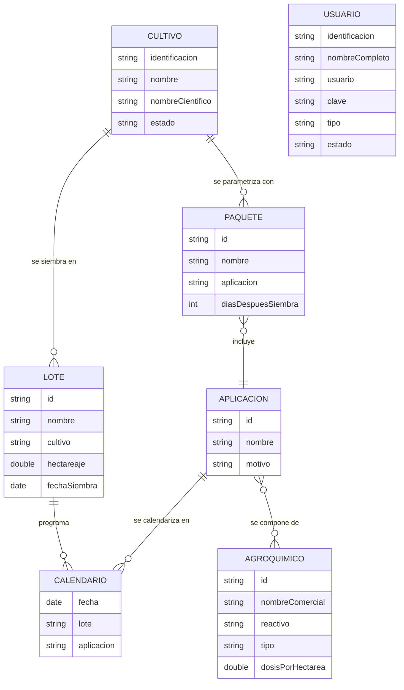

<div align="center">


<p>
  
  
  
  
</p>

<p>
  <b>ISW-321 · Programación Orientada a Objetos</b><br/>
  Universidad Técnica Nacional · Sede San Carlos · III Cuatrimestre 2026
</p>

</div>

---

## Contenido

1. [Resumen ejecutivo](#resumen-ejecutivo)
2. [Vista previa](#vista-previa)
3. [Módulos del sistema](#módulos-del-sistema)
4. [Control de acceso por rol](#control-de-acceso-por-rol)
5. [Modelo de dominio](#modelo-de-dominio)
6. [Lógica de calendarización y proyección](#lógica-de-calendarización-y-proyección)
7. [Arquitectura por capas](#arquitectura-por-capas)
8. [Estructura del proyecto](#estructura-del-proyecto)
9. [Persistencia en archivos de texto](#persistencia-en-archivos-de-texto)
10. [Requisitos y ejecución](#requisitos-y-ejecución)
11. [Equipo de desarrollo](#equipo-de-desarrollo)

---

## Resumen ejecutivo

**Control Agrícola** es una aplicación de escritorio desarrollada en **Java (Swing/AWT)** para **Agrícola Los 3 Patitos S.A.**, empresa dedicada a la producción y comercialización de productos cultivados.

El sistema centraliza el **registro, control y análisis** de lotes, cultivos y agroquímicos, y automatiza la **proyección de aplicaciones fitosanitarias y de fertilización**, cuya programación varía de un cultivo a otro. A partir de la parametrización definida por el usuario, genera el calendario de aplicaciones por lote y estima los materiales requeridos en cualquier rango de fechas.

**Objetivos**

- Gestionar de forma eficiente las aplicaciones a los cultivos de la empresa.
- Facilitar el registro y seguimiento de cultivos, sus aplicaciones y la proyección de materiales a utilizar.

---

## Vista previa


<div align="center">
  
</div>

---

## Módulos del sistema

Todos los módulos ofrecen operaciones **CRUD** (crear, consultar, modificar y eliminar), visualización en **tablas con valores legibles**, almacenamiento en memoria mediante **`ArrayList`** y persistencia en **archivos `.Json`**. Cada registro posee un **estado** (activo/inactivo) que determina si puede utilizarse en las demás interfaces.

| Módulo | Descripción funcional | Campos principales |
| :-- | :-- | :-- |
| **Seguridad y login** | Autenticación con validación de credenciales y de estado del usuario. Un usuario inactivo no puede ingresar aunque sus datos sean correctos. | Usuario, clave |
| **Usuarios** | Administración de las cuentas con acceso al sistema. | Identificación, nombre completo, nombre de usuario, clave, tipo, estado |
| **Cultivos** | Catálogo de los cultivos de la empresa. | Identificación, nombre, nombre científico, estado |
| **Lotes** | Registro de terrenos asociados a un cultivo. | Identificador, nombre, cultivo, hectareaje, fecha de siembra, estado |
| **Agroquímicos** | Catálogo de productos aplicables con su dosis recomendada. | Identificador, nombre comercial, reactivo, tipo, dosis por hectárea, estado |
| **Aplicaciones** | Definición de una aplicación como combinación de agroquímicos. | Identificador, nombre, motivo, agroquímicos que la componen, estado |
| **Paquetes de aplicaciones** | Parametrización de las aplicaciones por cultivo: agrupa aplicaciones y define cuándo aplicarlas. | Identificador, nombre, aplicación, días después de siembra, estado |
| **Calendario** | Cálculo y registro de las aplicaciones por día y por lote a partir de la parametrización. | Cultivo seleccionado, lotes, fecha, aplicaciones |
| **Reportes** | Consultas analíticas sobre el calendario y el consumo de productos. | Ver detalle a continuación |

**Tipos de agroquímico:** Herbicida · Fungicida · Insecticida · Bactericida · Fertilizante foliar

### Reportes

| Reporte | Parámetro de consulta | Columnas mostradas |
| :-- | :-- | :-- |
| **Calendario de aplicaciones** | Año | Fecha, lote, cultivo, aplicación |
| **Agroquímicos consumibles** | Rango de fechas | Cultivo, agroquímico, cantidad |

---

## Control de acceso por rol

| Funcionalidad | Administrador | Digitador |
| :-- | :--: | :--: |
| Inicio de sesión | ✅ | ✅ |
| Gestión de usuarios | ✅ | ❌ |
| Creación de lotes | ✅ | ❌ |
| Cultivos, agroquímicos, aplicaciones y paquetes | ✅ | ✅ |
| Calendario de aplicaciones | ✅ | ✅ |
| Reportes | ✅ | ✅ |

---

## Modelo de dominio



---

## Lógica de calendarización y proyección

**Fecha de aplicación.** Para cada lote del cultivo seleccionado, se recorre el paquete de aplicaciones parametrizado y se calcula:

```text
fecha de aplicación = fecha de siembra del lote + días después de siembra
```

**Consumo proyectado.** La cantidad de cada agroquímico se obtiene a partir de su dosis recomendada y del tamaño del lote:

```text
cantidad = dosis recomendada por hectárea × hectareaje del lote
```

**Validaciones de integridad**

- Solo se utilizan registros con estado **activo** en las interfaces dependientes (por ejemplo, un lote no puede asociarse a un cultivo inactivo).
- Los identificadores no pueden duplicarse dentro de un mismo módulo.
- Los campos obligatorios, los valores numéricos y las fechas se validan antes de almacenar.

---

## Arquitectura por capas

El código fuente está desacoplado en capas para facilitar el mantenimiento y el trabajo colaborativo.

```text
┌───────────────────────────────────────────────────────────┐
│              PRESENTACIÓN  (Swing / AWT)                  │  Ventanas, formularios y eventos
├───────────────────────────────────────────────────────────┤
│              LÓGICA  (Reglas de negocio)                  │  Controladores, validaciones y cálculos
├───────────────────────────────────────────────────────────┤
│              DATOS  (Entidades y persistencia)            │  Objetos, ArrayList y archivos .txt
└───────────────────────────────────────────────────────────┘
```

---

## Estructura del proyecto

```text
ControlAgricola/
├── src/
│   ├── Datos/          # Entidades y acceso a archivos (ObjUsuario, ObjCultivo, ObjLote,
│   │                   #   ObjAgroquimico, ObjAplicacion, ObjPaquete, ObjCalendario)
│   ├── Logica/         # Controladores, validaciones, cálculo de calendario y reportes
│   ├── Presentacion/   # Interfaces gráficas (JFrame, JPanel y formularios)
│   └── Imagenes/       # Recursos gráficos e iconos
├── Archivos/           # Archivos de texto .txt con la información del sistema
├── nbproject/          # Configuración del proyecto ANT de NetBeans
├── build.xml
└── README.md
```

---

## Persistencia en archivos de texto

El almacenamiento se realiza exclusivamente con archivos `.txt`. Al iniciar, el sistema carga cada archivo en su `ArrayList`; cada operación CRUD sincroniza los cambios con el archivo correspondiente.

| Archivo | Contenido |
| :-- | :-- |
| `usuarios.txt` | Usuarios del login y su tipo (administrador o digitador) |
| `cultivos.txt` | Catálogo de cultivos |
| `lotes.txt` | Lotes con cultivo, hectareaje y fecha de siembra |
| `agroquimicos.txt` | Productos aplicables y dosis por hectárea |
| `aplicaciones.txt` | Aplicaciones y los agroquímicos que las componen |
| `paquetes.txt` | Parametrización de aplicaciones por cultivo |
| `calendario.txt` | Aplicaciones programadas por día y por lote |

---

## Requisitos y ejecución

| Requisito | Detalle |
| :-- | :-- |
| Lenguaje | Java (JDK 8 o superior) |
| IDE | Apache NetBeans, proyecto tipo **ANT** |
| Interfaz | Swing/AWT con componentes nativos de NetBeans (sin librerías externas) |
| Almacenamiento | Archivos de texto `.txt` |

**Pasos**

1. Clone el repositorio:
   ```bash
   git clone <url-del-repositorio>
   ```
2. Abra la carpeta del proyecto desde **File → Open Project** en NetBeans.
3. Ejecute con **Run Project** (`F6`).
4. Inicie sesión con un usuario administrador registrado en `usuarios.txt`.

---

## Equipo de desarrollo

<div align="center">

| Desarrollador | Rol | GitHub |
| :-- | :-- | :--: |
| **Erick Jasiel López Borge** | Núcleo, lógica de negocio y arquitectura | [](https://github.com/ErickLopez-TECH) |
| **Dylan Álvarez** | Interfaces gráficas y módulos | [](https://github.com/) |
| **David Reyes** | Soporte técnico y control de calidad | [](https://github.com/) |

**Docente:** Dawer Alfaro Solís · **Curso:** ISW-321 Programación Orientada a Objetos

</div>


